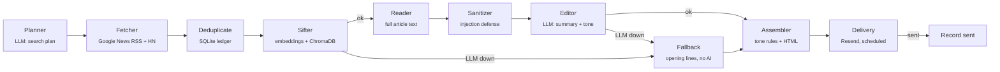

# ZenSift

**A calm daily news digest, built as an agentic LLM pipeline.**

ZenSift finds news on topics you care about, filters out rage-bait and doomscroll content, reads the full articles, and emails you short, factual summaries every morning. You never see the headlines. Headlines are written to provoke; ZenSift shows only the summary, the source and a link.

    

---

## Highlights

- **Agentic workflow.** A LangGraph state machine with conditional routing, graceful degradation and per-stage error isolation.
- **Semantic filtering.** Gemini embeddings plus ChromaDB score each article against your interests *and* your avoid list. An article must match an interest clearly better than any avoid topic to be kept.
- **Grounded summaries.** The editor reads the full publisher article, not the RSS snippet, and only summarizes what the text says, keeping exact figures.
- **Tone gating.** The LLM scores each original article from 0.0 (alarmist) to 1.0 (calm). Alarmist stories are dropped, and so are dramatic ones close to an avoid topic.
- **Prompt-injection defense.** Article text is escaped, stripped of invisible characters and wrapped in delimiters. URLs never reach the LLM.
- **Exactly-once delivery.** Resend idempotency keys plus a SQLite ledger mean no duplicate emails and no repeated articles.
- **Evaluated.** A RAGAS harness measures how faithful the summaries are to the article and how much of it they cover.
- **Serverless.** Runs daily on GitHub Actions (or Docker) for $0.

## Architecture



| Stage | What it does |
|---|---|
| **Planner** | Gemini turns your interests into 3 Google News queries and 3 Hacker News keywords (structured output, Pydantic-validated). |
| **Fetcher** | Downloads RSS and the HN Algolia API politely: sequential requests, timeouts, size caps, https only. |
| **Deduplicate** | Drops URLs already emailed (SQLite) and repeats within the run. |
| **Sifter** | Embeds articles, interests and avoid topics, then keeps the top N above a calibrated similarity threshold and avoid margin. |
| **Reader** | Resolves Google News redirects, fetches the publisher page, and extracts paragraphs from `<article>`/`<main>`. Retries once on 429/503 and drops pages it can't read (paywalls, PDFs, JS-only pages). |
| **Sanitizer** | Escapes and wraps each article in `<article>` tags so text can't break out or inject instructions. |
| **Editor** | Gemini writes at most 3 calm sentences and a `tone_score` per article. |
| **Assembler** | Applies tone rules, orders by relevance, and renders HTML and plain-text email. |
| **Delivery** | Sends via Resend with a daily idempotency key, scheduled for the configured time. |

**Failure handling.** LLM calls retry with exponential backoff (tenacity). If Gemini is still down, the graph routes to a no-AI fallback that sends the opening lines of the top stories, clearly labelled. Unreadable articles, failed feeds and a broken ledger are logged and skipped, never fatal.

## Tech stack

Python 3.12 · LangGraph · LangChain · Google Gemini (chat + embeddings) · ChromaDB · Pydantic v2 · Resend · SQLite · RAGAS · pytest · Docker · GitHub Actions · Poetry

## Getting started

### Prerequisites

- Python 3.12 and [Poetry](https://python-poetry.org/) 2.x
- A [Gemini API key](https://aistudio.google.com/apikey) (free tier is enough)
- A [Resend API key](https://resend.com/). On the free testing sender, Resend only delivers to the address you signed up with.

### Run locally

```bash
git clone https://github.com/Indu-304/ZenSift.git && cd ZenSift
poetry install
cp .env.example .env              # add GEMINI_API_KEY, RESEND_API_KEY, DIGEST_TO_EMAIL
poetry run python -m src.main --force-send   # send a digest right now
```

Without `--force-send`, a run sends at most one digest per day and schedules it for `delivery_time`.

### Run with Docker

```bash
docker build -t zensift .
docker run --rm --env-file .env -v "$PWD/data:/app/data" zensift --force-send
```

The `data/` volume keeps the sent-articles ledger between runs. The image contains runtime dependencies only and runs as a non-root user.

### Deploy on GitHub Actions

1. Push the repo to GitHub.
2. Under **Settings → Secrets and variables → Actions**, add the secrets `GEMINI_API_KEY`, `RESEND_API_KEY` and `DIGEST_TO_EMAIL`.
3. Optionally, add the variable `GEMINI_CHAT_MODEL`.
4. Trigger **Actions → Daily digest → Run workflow** once to confirm the setup.

[`.github/workflows/daily-digest.yml`](.github/workflows/daily-digest.yml) runs ahead of `delivery_time`, and Resend holds the email until that time, so GitHub's scheduling delays don't move the delivery time. The SQLite ledger is kept between runs in the Actions cache.

## Configuration

All preferences live in [`config.yaml`](config.yaml); secrets live in `.env`.

```yaml
delivery_time: "02:30"      # UTC; 08:00 IST
interests:                  # one concrete topic per entry
  - New open-source and open-weight LLM releases, benchmarks and licenses
avoid:                      # filtered out unless an interest clearly wins
  - Outrage, scandal and rage-bait stories written to provoke anger
sifter:  { similarity_threshold: 0.62, min_margin: 0.05, max_articles: 8 }
digest:  { hard_drop_tone: 0.15, avoid_drop_tone: 0.40, avoid_hit_similarity: 0.60 }
```

Unknown keys fail validation, so typos are caught instead of silently ignored.

## Evaluation

[`scripts/eval_ragas.py`](scripts/eval_ragas.py) scores Editor summaries against the exact text the Editor saw, using Gemini as the judge.

| Metric | Measures |
|---|---|
| `faithfulness` | Share of the summary's claims the article supports. Catches made-up facts. |
| `summary_score` | Coverage of the article's key information, with a penalty for length. |

```bash
poetry run python -m scripts.eval_ragas                          # today's articles; saves a snapshot
poetry run python -m scripts.eval_ragas --snapshot data/eval/snapshot-<ts>.jsonl   # re-score after a prompt change
poetry run python -m scripts.eval_ragas --update-readme          # also write the results below
```

Each run prints per-article scores, writes a CSV to `data/eval/`, and exits non-zero if mean faithfulness is below `--min-faithfulness` (default 0.8). Snapshots make prompt changes comparable on the same articles.

### Results

<!-- eval-results:start -->
Last run: 2026-10-24 · 8 live articles · editor and judge: `gemini-3.5-flash-lite`

| Metric | Result |
|---|---|
| Mean faithfulness | **0.96** |
| Fully faithful summaries | 7 / 8 |
| Mean summary score | **0.71** |
<!-- eval-results:end -->

## Testing

```bash
poetry run pytest -q
```

220 offline tests cover every node, routing, retry behaviour, HTML escaping, prompt-injection handling and idempotency. Network, LLM and email calls are blocked by fixtures, so a test can never send a real request.

## Project structure

```
src/
├── main.py              # CLI entry point
├── config.py            # config.yaml schema (Pydantic, strict)
├── graph/
│   ├── state.py         # shared state and Article model
│   └── workflow.py      # LangGraph DAG, routing, fallback
├── agents/
│   ├── planner.py       # LLM search planning
│   ├── sifter.py        # embedding-based relevance filter
│   ├── editor.py        # LLM summaries + tone scoring
│   └── llm.py           # model factory, retry policy
└── utils/
    ├── fetcher.py       # RSS + HN fetching
    ├── deduplicate.py   # SQLite sent ledger
    ├── reader.py        # full-text extraction
    ├── sanitizer.py     # prompt-injection defense
    ├── assembler.py     # tone rules + email rendering
    └── delivery.py      # Resend, idempotency, scheduling
scripts/eval_ragas.py    # RAGAS evaluation
tests/                   # pytest suite
```

## License

[MIT](LICENSE)
